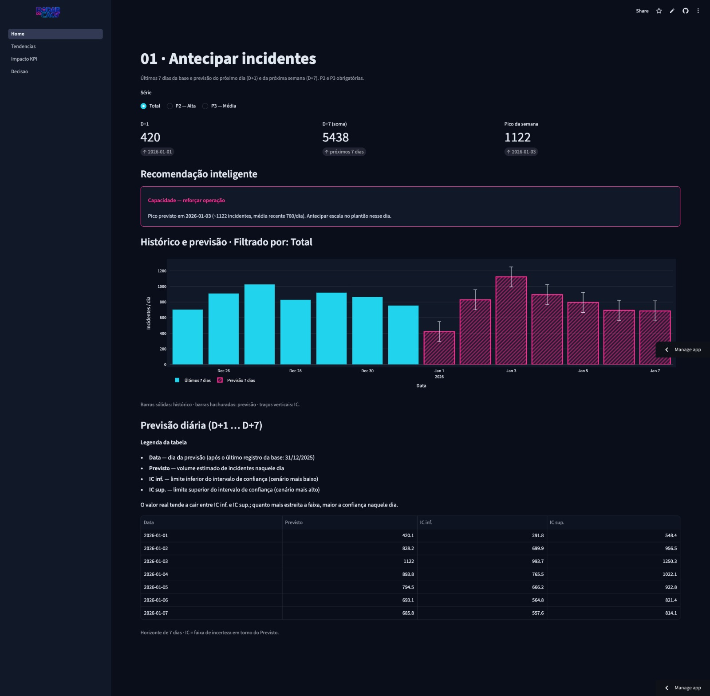
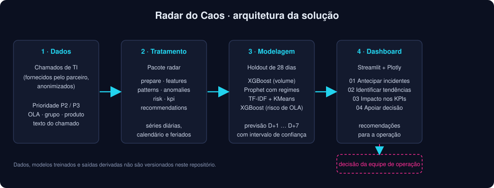
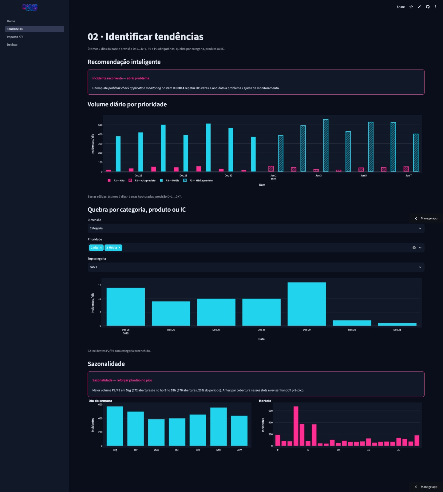
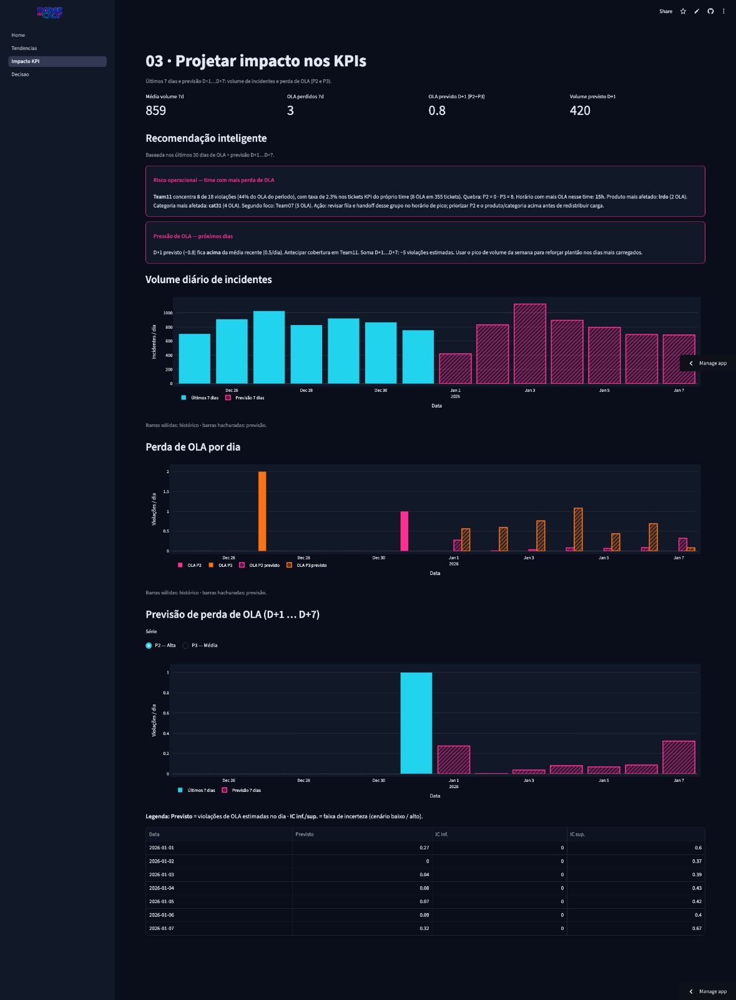
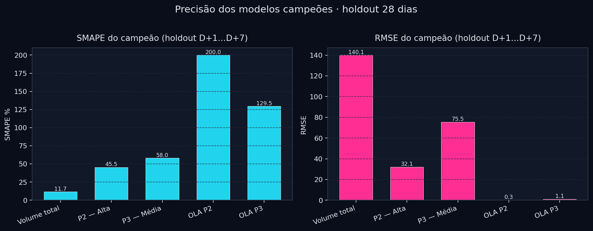
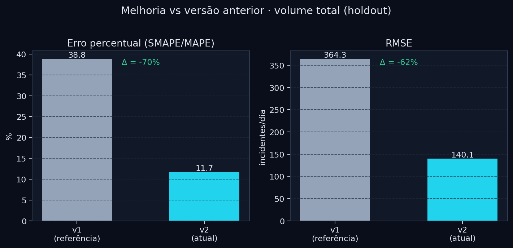

<p align="center">
  
</p>

<h1 align="center">Radar do Caos</h1>

<p align="center">
  Previsão de incidentes e priorização de alertas para operações de TI (AIOps).<br>
  Projeto do <b>Enterprise Challenge FIAP × Locaweb (2026)</b> · Grupo Orango · Tecnólogo em Ciência de Dados
</p>

<p align="center">
  
  
  
  
</p>



> **Sobre os dados:** os dados de chamados foram fornecidos pela Locaweb para fins educacionais e **não estão neste repositório**. O código está completo, mas o pipeline e o dashboard só rodam com a base original (ou outra com o mesmo esquema). Modelos treinados e saídas derivadas também ficam de fora. Os prints abaixo usam identificadores anonimizados (`IC00014`, `Team11`, `cat71`).

## O problema
Equipes de operação recebem milhares de chamados e alertas todos os dias. O desafio era transformar esse histórico em inteligência preditiva: **antecipar o volume de incidentes**, identificar padrões e anomalias e **recomendar ações** para a operação, incluindo o risco de perder o OLA (acordo de nível operacional).

## Arquitetura


| Etapa | Pasta | O que faz |
|---|---|---|
| Tratamento | [`tratamento/radar/`](tratamento/radar) | Pacote Python modular: preparo dos dados, features, previsão, risco, anomalias, padrões recorrentes, KPIs e recomendações |
| Modelagem | [`modelagem/`](modelagem) | Treino e comparação de modelos com holdout de 28 dias e horizonte D+1 a D+7 |
| Dashboard | [`dashboard/`](dashboard) | App Streamlit com 4 páginas orientadas à decisão |

### Modelos
- **Volume de incidentes:** XGBoost com lags, médias móveis, calendário e feriados; Prophet com regimes; baseline sazonal como referência. O campeão é escolhido por série no holdout.
- **Agrupamento de chamados:** TF-IDF + MiniBatchKMeans sobre a descrição, para achar causas recorrentes.
- **Risco de perder OLA:** classificador XGBoost.

## Dashboard
| 02 · Identificar tendências | 03 · Projetar impacto nos KPIs |
|---|---|
|  |  |

Cada página traz uma **recomendação inteligente** gerada a partir da previsão e dos padrões (por exemplo, reforçar o plantão no dia de pico previsto ou abrir um problema para um incidente recorrente).

## Resultados
Avaliação no holdout dos últimos 28 dias, horizonte D+1…D+7.



| Série | Modelo campeão | SMAPE |
|---|---|---|
| Volume total | XGBoost | **11,7%** |
| P2 (alta) | Prophet com regimes | 45,5% |
| P3 (média) | XGBoost | 58,0% |

A versão final reduziu o erro do volume total em **70%** (SMAPE) e **62%** (RMSE) em relação à versão anterior:



### Limitações
- As séries de **OLA** têm volume muito baixo e muitos zeros. O erro absoluto é pequeno (RMSE de 0,3 e 1,1), mas o SMAPE passa de 129%, então essas previsões servem como sinal de pressão, não como número exato.
- O classificador de risco de OLA tem **AUC 0,795, mas F1 0,043**: ele ordena bem os casos por risco, porém a classe é muito rara e a decisão de corte não está calibrada. Ver [`evidencias/05_xgboost_ola_classifier.png`](evidencias/05_xgboost_ola_classifier.png).
- Só cerca de 37% dos registros têm produto e categoria preenchidos, o que limita a quebra por produto.

Mais gráficos em [`evidencias/`](evidencias) e métricas completas em [`modelagem/metrics.json`](modelagem/metrics.json).

## Estrutura
```
tratamento/   pipeline (pacote radar)
modelagem/    scripts de treino e métricas
dashboard/    app Streamlit
evidencias/   gráficos de precisão dos modelos
docs/img/     imagens deste README
```

## Como executar
Requer a base original em `data/` (não incluída).
```bash
pip install -r requirements.txt
python -m radar                     # a partir de tratamento/: gera as séries, previsões e recomendações
python modelagem/scripts/train.py   # treina e compara os modelos
streamlit run dashboard/app/Home.py
```
Os caminhos esperados dos dados estão em [`tratamento/radar/config.py`](tratamento/radar/config.py). Os scripts foram movidos desta forma para o repositório e **não foram reexecutados** sem a base; pode ser necessário ajustar caminhos.

## Stack
Python, pandas, NumPy, scikit-learn, XGBoost, Prophet, Streamlit, Plotly.
